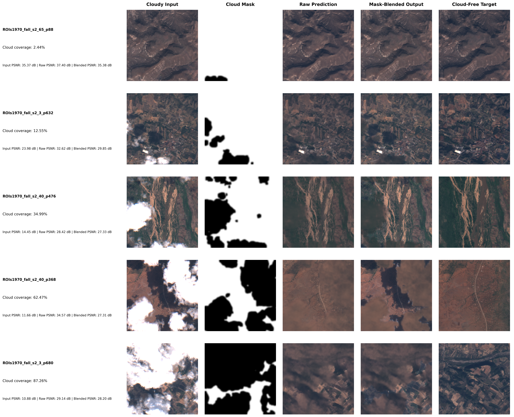

# ECRformer-Lite — Epoch-30 EMA Baseline Archive

Private artifact archive for preserving the previous best checkpoint and its generated outputs before the gradient-loss pilot. This repository is a **baseline snapshot**, not a training-code or dataset mirror.

## Baseline checkpoint

| Field | Value |
|---|---|
| Checkpoint | [`checkpoint/best_model.pth`](checkpoint/best_model.pth) |
| Epoch | 30 |
| Inference weights | `ema_state_dict` (277 tensors) |
| Original checkpoint size | 58,406,779 bytes |
| SHA-256 | `2f02aca75619a8b4db52ca5ef4910a0ad305e80c68d48c035c0bb975e5b1a5b6` |
| Original checkpoint metadata PSNR | 30.1982 dB; stored metric uses blended semantics and is not directly comparable with the full-256 table below |

The archive preserves the original checkpoint byte-for-byte. For inference, load `ema_state_dict`, not `model_state_dict`. The separate SHA-256 record is in [`checkpoint/SHA256SUMS`](checkpoint/SHA256SUMS).

## Full-256×256 generated outputs

The output archive contains 12 selected validation patches, each with raw `pred_direct` and mask-blended float32 arrays, plus per-patch six-panel detail figures and contact sheets. Arrays have shape `(256, 256, 4)` and channel order **R, G, B, NIR**. Display clipping applies only to the PNGs; saved arrays are unmodified.

- [`outputs/full256_epoch30/raw_float/`](outputs/full256_epoch30/raw_float/) — raw model predictions.
- [`outputs/full256_epoch30/blended_float/`](outputs/full256_epoch30/blended_float/) — mask-blended predictions.
- [`outputs/full256_epoch30/figures/`](outputs/full256_epoch30/figures/) — detail comparison panels.
- [`outputs/full256_epoch30/contact_sheet_full256_typical.png`](outputs/full256_epoch30/contact_sheet_full256_typical.png)
- [`outputs/full256_epoch30/contact_sheet_full256_hard.png`](outputs/full256_epoch30/contact_sheet_full256_hard.png)
- [`outputs/cloud_coverage/five_coverage_stack_final.png`](outputs/cloud_coverage/five_coverage_stack_final.png) · [PDF](outputs/cloud_coverage/five_coverage_stack_final.pdf)



The panel convention is input, clean target, raw prediction, blended output, mask, and absolute error. The project mask convention is `mask > 0.1` = cloudy. Full-256 blending follows `output = (1 - mask) * cloudy_input + mask * pred_direct`.

### Full-patch metrics — 12 selected validation patches

All-pixel PSNR and MAE across all four bands, in reflectance units with peak value 1.0. These are **per-patch** values, not a pooled 1,115-patch validation score. `RAW` is the direct network output; `Blend` is the mask-blended output.

| Sample | Cloud % | Input PSNR (dB) | Raw PSNR (dB) | Blend PSNR (dB) | Raw MAE |
|---|---:|---:|---:|---:|---:|
| s2_40_p512 | 38.03 | 13.84 | 34.69 | 26.56 | 0.0152 |
| s2_22_p584 | 62.31 | 21.27 | 37.13 | 31.72 | 0.0079 |
| s2_119_p496 | 67.68 | 22.87 | 30.94 | 28.17 | 0.0203 |
| s2_134_p56 | 100.00 | 8.40 | 44.09 | 44.09 | 0.0047 |
| s2_134_p136 | 98.96 | 16.24 | 28.48 | 28.31 | 0.0195 |
| s2_119_p208 | 0.00 | 10.76 | 24.94 | 10.76 | 0.0380 |
| s2_119_p236 | 0.86 | 10.63 | 22.79 | 10.63 | 0.0511 |
| s2_119_p268 | 15.86 | 15.44 | 23.37 | 15.60 | 0.0487 |
| s2_119_p100 | 100.00 | 23.45 | 26.50 | 26.50 | 0.0304 |
| s2_119_p264 | 5.43 | 23.03 | 28.03 | 23.08 | 0.0232 |
| s2_134_p484 | 50.20 | 25.07 | 30.29 | 30.21 | 0.0205 |
| s2_22_p808 | 25.94 | 21.71 | 34.36 | 29.56 | 0.0099 |

Across these 12 patches, the **unweighted per-patch mean** is 30.47 dB raw PSNR versus 25.43 dB blended PSNR (input mean 17.72 dB). This is a descriptive summary of this selected cohort only—not a dataset-wide estimate. Raw predictions had zero non-finite, below-zero, or above-one values in the source diagnostics. The blended output can fall back to the cloudy input where the cloud mask is nearly empty (notably p208 and p236).

Detailed CSVs: [`metrics/full256_per_patch_metrics.csv`](metrics/full256_per_patch_metrics.csv) and [`metrics/full256_manifest.csv`](metrics/full256_manifest.csv).

### Earlier fixed-cohort metric file — 8 patches

This is preserved separately from the 12-patch full-256 file. Gradient ratio is the raw prediction's gradient magnitude divided by the target's.

| Sample | Cloud % | Input PSNR (dB) | Raw PSNR (dB) | Blend PSNR (dB) | Raw gradient ratio |
|---|---:|---:|---:|---:|---:|
| s2_119_p208 | 0.00 | 10.76 | 24.94 | 10.76 | 0.274 |
| s2_119_p236 | 0.86 | 10.63 | 22.79 | 10.63 | 0.233 |
| s2_119_p92 | 0.00 | 13.61 | 27.87 | 13.61 | 0.478 |
| s2_40_p268 | 5.64 | 25.83 | 28.20 | 28.37 | 0.629 |
| s2_65_p328 | 0.00 | 31.14 | 27.46 | 31.14 | 0.762 |
| s2_65_p124 | 0.77 | 41.30 | 42.85 | 41.39 | 0.837 |
| s2_119_p100 | 100.00 | 23.45 | 26.51 | 26.51 | 0.654 |
| s2_65_p336 | 89.33 | 23.26 | 34.43 | 34.25 | 0.833 |

Source table: [`metrics/fixed_cohort_baseline_metrics.csv`](metrics/fixed_cohort_baseline_metrics.csv). Keep this cohort distinct from other crop, mask-restricted, or validation summaries; do not combine metrics computed over different regions or masks.

## Provenance and limits

- The full-256 outputs use the epoch-30 EMA checkpoint, no crop/resize/padding, and the project’s existing preprocessing.
- The 12 outputs are selected validation patches; this is not a rerun of the entire validation split.
- The held-out scene `s2_139` was not accessed.
- Training cache/dataset, source code, training history, and later checkpoints are deliberately not included. The original project code/environment is required to load and run this checkpoint.
- This archive does **not** replace the protected local baseline or authorize training. The epoch-30 baseline in the project remains unchanged.

## Restore / verify

Clone this private repository, verify the checkpoint digest, then copy the checkpoint back only if restoration is needed:

```bash
git clone https://github.com/yovyshh/ecrformer-lite-baseline-archive.git
cd ecrformer-lite-baseline-archive
sha256sum -c checkpoint/SHA256SUMS
```

The expected digest is also printed in the checkpoint table above. Load `checkpoint/best_model.pth` with the original model implementation and `ema_state_dict` for baseline inference. Do not overwrite a project checkpoint until the digest has verified.
